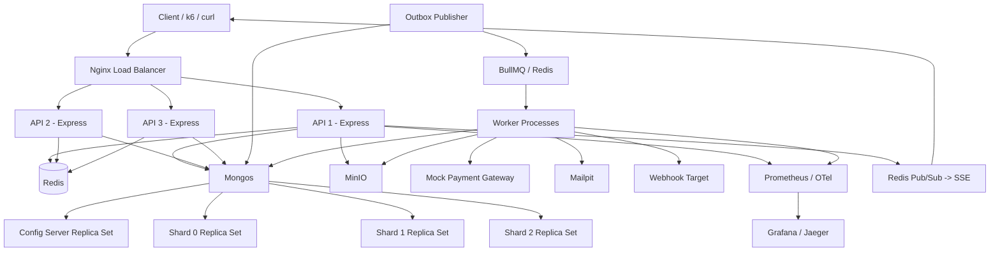
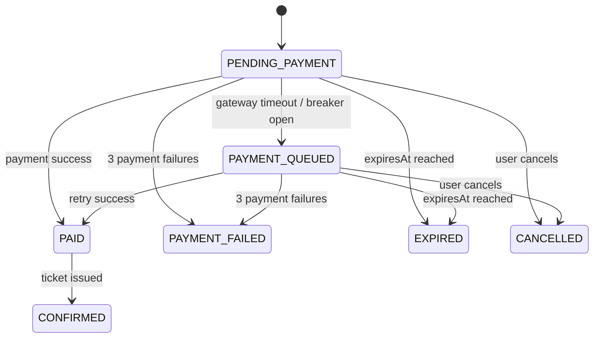

# PRD — TixWar: Flash Sale Ticketing API

**Tugas Study Club — REST API (Express, Bun, TypeScript, MongoDB)**  
**Status:** Baseline implementation specification  
**Versi:** 2.0 — diselaraskan dengan TSC Finpro  
**Dokumen acuan:** `TSC_Finpro.md`

> Dokumen ini adalah sumber kebenaran untuk coding agent. Baca seluruh dokumen sebelum scaffold atau mengubah kode. Kerjakan berdasarkan milestone pada Bagian 16 dan jangan berhenti sebelum seluruh Definition of Done pada Bagian 17 terpenuhi. Jika repository sudah berisi implementasi, audit dan lanjutkan pekerjaan yang ada; jangan menimpa pekerjaan valid.

---

## 1. Ringkasan

TixWar adalah backend penjualan tiket event dengan skenario _flash sale_: ribuan pengguna berebut stok terbatas dalam hitungan detik. Fokus utama bukan CRUD biasa, melainkan system design yang tahan beban: tidak oversell, tidak membuat order ganda, tetap beroperasi ketika dependency eksternal bermasalah, dan seluruh perilakunya dapat diamati saat presentasi melalui trace, metrik, dan log. Proyek ini murni backend: tidak ada kode frontend.

Tujuan proyek:

1. Memenuhi seluruh fitur wajib tugas Finpro dan membuktikannya dengan test, benchmark, metrik, serta dashboard Grafana.
2. Menyediakan alur end-to-end yang bisa didemonstrasikan: registrasi, melihat event, reservasi, pembayaran, penerbitan tiket, dan notifikasi.
3. Menjelaskan keputusan arsitektur melalui diagram system design dan Architecture Decision Record (ADR).
4. Menjaga implementasi tetap berupa modular monolith dengan proses API, worker, dan outbox publisher yang terpisah; bukan microservices penuh.
5. Menggunakan MongoDB replica set dan native sharding sesuai TSC Finpro. Redis tetap digunakan untuk operasi berkecepatan tinggi dan koordinasi sementara.

**Prinsip utama:** Redis menjadi _atomic stock gate_ saat sale; MongoDB menjadi catatan durable. MongoDB transaction digunakan untuk perubahan dokumen yang harus atomik dalam satu shard. Outbox, BullMQ, dan saga menangani efek samping lintas proses/dependency.

## 2. Fitur wajib dan bukti implementasi

| Fitur                | Implementasi wajib                                                                               | Bukti penerimaan                                                     |
| -------------------- | ------------------------------------------------------------------------------------------------ | -------------------------------------------------------------------- |
| Rate limiter         | `rate-limiter-flexible` dengan Redis, tier IP/user/endpoint, fallback in-memory lebih ketat      | Header `RateLimit-*`, `Retry-After`, test 429, metrik penolakan      |
| Caching              | Cache-aside Redis, invalidasi versi, anti-stampede, ETag/304                                     | Test cache, rasio hit, benchmark sebelum/sesudah                     |
| Pagination           | Offset dan cursor/keyset berbasis `_id` dengan urutan stabil                                     | Response metadata, links, test batas dan konsistensi                 |
| Param beauty         | Filter, sort, fields, search, include; Zod strict; error per-field                               | Test parameter valid/tidak valid dan dokumentasi OpenAPI             |
| MongoDB sharding     | Native sharded cluster via `mongos`; shard key dan indeks dirancang eksplisit                    | Distribusi dokumen per shard, metrik, dry-run dan verifikasi reshard |
| Event-driven         | Outbox pattern, Change Streams atau polling yang tahan restart, BullMQ, worker, retry, DLQ, saga | Test outbox, deduplikasi, retry, replay DLQ, simulasi gateway down   |
| Security             | Helmet eksplisit, CORS whitelist, JWT, RBAC, API key, validasi input                             | Test header, auth, role, injection, dan secret handling              |
| Resilience           | Circuit breaker, timeout, retry/backoff/jitter, bulkhead, fallback                               | Test dependency failure dan status breaker                           |
| Observability        | Pino, Prometheus, Grafana, Loki/Promtail, Alertmanager, Sentry, OTel/Jaeger                      | Dashboard, query log, trace end-to-end, alert rule                   |
| System design & demo | C4, diagram request/saga, stream trace backend, chaos, load generator                            | README, diagram, bukti demo dan benchmark                            |

Tidak boleh menghapus fitur dari daftar ini hanya karena implementasi menjadi kompleks. Jika ada kompromi, tulis ADR yang menjelaskan alasan, dampak, dan bukti bahwa fungsi inti tetap terjaga.

## 3. Non-goals

- Kubernetes, service mesh, dan microservices penuh.
- Frontend dalam bentuk apa pun: aplikasi web, aplikasi mobile, maupun dashboard HTML/SVG/Canvas kustom. Proyek ini murni backend. UI yang dipakai hanya tool bawaan pihak ketiga (Swagger UI, Grafana, Jaeger, Mailpit, MinIO console) dan tidak boleh ada kode UI buatan sendiri di repository.
- Payment gateway asli. Gunakan mock gateway dengan endpoint untuk mengatur kegagalan dan latency.
- Refund kompleks, seat map, multi-currency, dan integrasi vendor tiket sungguhan.
- Menjanjikan high availability produksi dari konfigurasi Docker development yang hanya memakai satu anggota per shard. Konfigurasi lokal harus menjelaskan batasan topologinya.

## 4. Technology stack dan aturan pemilihan

Semua teknologi berikut berasal dari TSC Finpro. Jangan mengganti teknologi inti tanpa ADR dan persetujuan pemilik proyek.

### 4.1 Runtime dan tooling

- Bun dan TypeScript strict.
- `bun test` untuk unit, integration, dan E2E test.
- Biome untuk lint dan format.
- Husky pre-commit menjalankan `biome check` dan `tsc --noEmit`; `lint-staged` opsional.
- GitHub Actions: Biome, TypeScript check, test, dan build Docker image.
- Dependabot dan `bun audit` pada CI atau workflow keamanan.
- `justfile` (atau Makefile bila `just` tidak tersedia) untuk perintah standar.
- `.env.example`; seluruh env divalidasi dengan Zod saat startup.

### 4.2 API

- Express, `cors` dengan whitelist ketat, Helmet, compression gzip/brotli.
- Zod untuk validasi dan `zod-to-openapi` untuk spesifikasi API.
- `swagger-ui-express` di `/docs`; spesifikasi di `/openapi.json`.
- Pino dan `pino-http` untuk structured logging.
- RFC 7807 (`application/problem+json`) untuk error.
- Body size limit default 100 KB, dapat dikonfigurasi.
- API versioning `/v1`, request/correlation ID, header deprecation dan sunset bila diperlukan.
- PATCH partial update berbasis `$set`/`$unset`; bulk admin menggunakan `bulkWrite`.
- Offset pagination dan cursor pagination; cursor default menggunakan `_id` atau pasangan sort key + `_id`.
- ETag/304 untuk resource yang di-cache.
- Koleksi request Bruno atau Postman.

### 4.3 Auth dan keamanan

- `jose` untuk JWT access dan refresh token.
- `Bun.password` untuk hash password Argon2.
- RBAC middleware (`user`, `admin`).
- API key per client untuk endpoint integrasi; simpan hash, jangan plaintext.
- Login limiter khusus dan lockout.
- `rate-limiter-flexible` dengan Redis store.
- Idempotency key disimpan durable di MongoDB dengan unique index dan TTL index; Redis boleh dipakai sebagai lapisan cepat untuk status in-flight/respons.
- Secret hanya dari environment atau Docker secrets.
- Validasi Zod strict dan penolakan operator/dotted path dari input untuk mencegah NoSQL injection.

### 4.4 Data layer — MongoDB

- MongoDB sharded cluster dengan `mongos`, config server replica set, dan shard replica set.
- Driver resmi `mongodb` sebagai pilihan default. Mongoose boleh dipilih hanya bila ada alasan kuat dan dicatat di ADR; jangan mencampur driver pada domain yang sama.
- `migrate-mongo` untuk migrasi/index management; JSON Schema validation di level database untuk koleksi penting.
- Faker untuk seed data.
- Connection pooling memakai `MongoClient` (`maxPoolSize`, `minPoolSize`, `maxConnecting`, timeout yang sesuai); tidak menggunakan PgBouncer.
- Replica read memakai read preference `secondaryPreferred` atau `secondary` untuk query yang boleh eventual-consistent. Operasi sensitif dan read-your-writes memakai primary.
- Write concern `majority` untuk operasi durable penting; read concern dan read preference ditentukan per use case.
- Native sharding dengan `mongos`; tidak membuat consistent-hash ring aplikasi sendiri.
- Shard key default koleksi transaksi: `{ userId: 1 }` (ranged). `userId` harus berupa ID acak/non-sekuensial agar insert tidak terkonsentrasi di ujung rentang. Pilihan ini memudahkan compound unique index yang diawali shard key. Jika agent memilih hashed shard key, wajib menjelaskan konsekuensi unique index MongoDB dan membuktikan strategi idempotency/keunikan yang tetap benar dalam ADR.
- MongoDB transaction digunakan untuk dokumen yang berada di shard yang sama. Hindari distributed transaction lintas koleksi/global-shard jika alur bisa dirancang dengan outbox dan kompensasi.
- Text index MongoDB untuk full-text search event; Atlas Search tidak menjadi dependency wajib.
- Time-series collection + TTL index untuk telemetry/log/event observability yang cocok dengan pola append-only. Outbox dan data transaksi tetap regular collection karena statusnya perlu di-update.
- Soft delete dan audit log. Change Streams boleh digunakan untuk outbox/observability setelah kompatibilitas dan resume behavior diuji.

### 4.5 Redis, async, dan event-driven

- Redis untuk cache, rate limiter, stock gate, lock anti-stampede, pub/sub, dan fast idempotency/in-flight state.
- BullMQ menggunakan ioredis; queue dipisah berdasarkan domain kerja.
- Outbox ditulis dalam MongoDB transaction yang sama dengan perubahan aggregate terkait. Publisher menggunakan Change Streams sebagai jalur utama atau polling terkontrol; strategi dipilih dan didokumentasikan di ADR. Keduanya harus mendukung restart, duplicate delivery, dan recovery.
- Worker terpisah untuk order, payment, notification, webhook, dan expiry.
- Nodemailer dikirim ke Mailpit.
- Webhook HMAC SHA-256 menggunakan `node:crypto`.
- SSE untuk stok dan status order.
- RabbitMQ/Kafka hanya opsi P2; bukan bagian implementasi wajib.

### 4.6 Resilience

- `opossum`, satu breaker per dependency/host.
- Timeout eksplisit (`serverSelectionTimeoutMS`, `connectTimeoutMS`, `socketTimeoutMS`, `maxTimeMS` sesuai operasi).
- Retry hanya untuk operasi yang aman/idempoten, memakai exponential backoff + jitter.
- Bulkhead dengan concurrency terpisah per queue.
- Retryable reads/writes MongoDB dan write concern `majority` untuk operasi penting.
- Fallback dan graceful degradation.
- Graceful shutdown menutup HTTP server, worker, Redis, dan `MongoClient`.
- `/health` dan `/ready`; readiness melakukan ping MongoDB dan Redis serta mengecek status dependency yang relevan.
- Mock external service menyediakan `/toggle-fail` dan `/latency`.

### 4.7 Infra, observability, testing, dokumentasi

- Nginx sebagai load balancer ke 2–3 instance API.
- Docker multi-stage menggunakan `oven/bun`; Docker Compose untuk seluruh service.
- MongoDB compose topology menyertakan config server replica set, minimal tiga shard dalam mode sharded, `mongos`, dan init script. Mode lokal default boleh menggunakan satu anggota per shard untuk menghemat resource. Sediakan profile `ha` yang menambahkan secondary untuk shard replica set; integration test read preference wajib dijalankan pada profile tersebut agar pembacaan secondary benar-benar terbukti. Jangan mengklaim topologi single-node sebagai HA.
- Pino + pino-http; `prom-client`, Prometheus, Grafana, `mongodb_exporter`, Loki, Promtail, Alertmanager, Sentry, OpenTelemetry, dan Jaeger.
- Unit/integration/E2E memakai `bun test`; Testcontainers modul MongoDB replica set. Untuk integration yang menguji sharding native, gunakan compose test profile karena replica set tunggal tidak membuktikan routing sharded.
- k6 dengan threshold p95 dan autocannon untuk benchmark cepat.
- draw.io/Excalidraw dan Mermaid; C4 context/container, request flow, saga, runbook, ADR.

## 5. Arsitektur sistem

### 5.1 Gambaran komponen



### 5.2 Service Docker Compose

Service minimum:

- `nginx`
- `api-1`, `api-2`, `api-3` (dapat dijalankan sebagai satu service dengan replicas jika konfigurasi Compose mendukungnya)
- `worker`
- `outbox-publisher`
- `mock-gateway`
- `redis`
- `mongo-config-1`, `mongo-config-2`, `mongo-config-3` sebagai config server replica set
- `mongo-shard-0`, `mongo-shard-1`, `mongo-shard-2` sebagai primary shard replica set untuk mode lokal; profile `ha` menambahkan secondary
- `mongos`
- `minio`, `mailpit`
- `prometheus`, `grafana`, `mongodb-exporter`, `loki`, `promtail`, `alertmanager`, `jaeger`

Untuk mode lokal, tiap shard boleh berupa satu anggota replica set. Dokumentasikan bahwa mode tersebut membuktikan native sharding dan transaksi replica-set, tetapi bukan high availability node-level. Profile `ha` dapat menambahkan secondary untuk setiap shard jika resource tersedia.

### 5.3 Prinsip arsitektur

1. API bersifat stateless; shared state disimpan di Redis atau MongoDB.
2. Semua akses koleksi sharded transaksi melalui `mongos`, bukan koneksi langsung ke shard.
3. MongoDB adalah catatan durable; Redis adalah gerbang stok berlatensi rendah, bukan satu-satunya sumber order.
4. Operasi order, payment, ticket, outbox, dan processed-event untuk satu user menggunakan shard key `userId` agar perubahan satu order berada di shard yang sama.
5. Event dan tier berada di koleksi global/unsharded karena menjadi katalog bersama. Query katalog dapat membaca secondary; alur yang membutuhkan data paling baru memakai primary.
6. Hindari transaksi lintas shard/database. Gunakan outbox + saga + kompensasi untuk efek samping lintas dependency.
7. Delivery event bersifat at-least-once. Konsumer harus idempoten.
8. Setiap request memiliki `requestId` yang diteruskan ke log, event, queue job, dan trace.
9. Semua operasi pemulihan stok harus idempoten dan bisa direkonsiliasi.

## 6. Domain, koleksi, dan skema data

MongoDB menggunakan `_id` string dengan prefix domain agar ID API mudah dibaca. Dokumen boleh memiliki field `createdAt` dan `updatedAt` sebagai BSON Date UTC. Response API mengubah `_id` menjadi `id` dan tidak mengekspos field internal.

### 6.1 Koleksi global / unsharded

| Collection         | Field utama                                                                                                                                                    | Index / aturan                                                                                                               |
| ------------------ | -------------------------------------------------------------------------------------------------------------------------------------------------------------- | ---------------------------------------------------------------------------------------------------------------------------- |
| `users`            | `_id` (`usr_` + UUIDv4 acak), `email`, `passwordHash`, `role`, `createdAt`, `updatedAt`, `deletedAt`                                                           | Unique `{ email: 1 }`; email dinormalisasi lowercase dan trim                                                                |
| `events`           | `_id` (`evt_` + ULID), `name`, `description`, `category`, `city`, `venue`, `startsAt`, `status`, `searchText`, `createdAt`, `updatedAt`, `deletedAt`           | Text index `name`, `description`; index status/category/city/startsAt                                                        |
| `ticketTiers`      | `_id` (`tier_` + ULID), `eventId`, `name`, `price` (integer rupiah), `quota`, `saleStartsAt`, `saleEndsAt`, `maxPerUser` (default 4), `createdAt`, `updatedAt` | Index `{ eventId: 1, saleStartsAt: 1 }`; validasi quota dan price                                                            |
| `webhookEndpoints` | `_id`, `ownerId`, `url`, `secretHash`/secret terenkripsi, `active`, `createdAt`                                                                                | Index owner; secret mentah hanya ditampilkan sekali saat registrasi                                                          |
| `eventStats` (P2)  | `eventId`, `sold`, `revenue`, `updatedAt`                                                                                                                      | Read model; bukan sumber kebenaran transaksi                                                                                 |
| `idempotencyKeys`  | `_id`, `scope`, `ownerId`, `key`, `requestHash`, `response`, `status`, `expiresAt`, `createdAt`                                                                | Unique `{ scope: 1, ownerId: 1, key: 1 }`; TTL `{ expiresAt: 1 }`; koleksi unsharded agar unique constraint global sederhana |

`users`, `events`, `ticketTiers`, dan `idempotencyKeys` tetap unsharded pada baseline. Alasan: ukuran/akses katalog relatif kecil dibanding transaksi, user lookup harus mudah, dan unique key idempotency perlu ditegakkan secara global. Jika skala mengharuskan koleksi ini di-shard, perubahan wajib melalui ADR yang menjelaskan batasan unique index MongoDB.

### 6.2 Koleksi transaksi — shard key `{ userId: 1 }`

Koleksi berikut di-shard menggunakan ranged shard key `{ userId: 1 }`. `userId` harus acak/non-sekuensial (`usr_` + UUIDv4), bukan timestamp ID. Semua query pengguna menyertakan `userId`, sehingga mongos dapat mengarahkan query ke shard terkait.

| Collection        | Field utama                                                                                                                                                  | Index / aturan                                                                                                        |
| ----------------- | ------------------------------------------------------------------------------------------------------------------------------------------------------------ | --------------------------------------------------------------------------------------------------------------------- |
| `orders`          | `_id` (`ord_` + ULID), `userId`, `eventId`, `tierId`, `quantity`, `unitPrice`, `total`, `status`, `expiresAt`, `createdAt`, `updatedAt`, `deletedAt`         | Compound unique `{ userId: 1, _id: 1 }`; index `{ userId: 1, createdAt: -1, _id: -1 }` dan `{ userId: 1, status: 1 }` |
| `payments`        | `_id` (`pay_` + ULID), `orderId`, `userId`, `status` (`QUEUED`, `SUCCEEDED`, `FAILED`), `attempt`, `providerRef`, `idempotencyKey`, `createdAt`, `updatedAt` | Unique `{ userId: 1, _id: 1 }`; index `{ userId: 1, orderId: 1 }`                                                     |
| `tickets`         | `_id` (`tix_` + ULID), `orderId`, `userId`, `code`, `qrObjectKey`, `issuedAt`                                                                                | Unique `{ userId: 1, _id: 1 }` dan `{ userId: 1, code: 1 }`; order index                                              |
| `outboxEvents`    | `_id`, `userId`, `aggregateType`, `aggregateId`, `type`, `payload`, `status`, `attempts`, `createdAt`, `publishedAt`, `leaseUntil`                           | Index `{ userId: 1, status: 1, createdAt: 1 }`; status/lease diubah publisher; regular collection                     |
| `processedEvents` | `_id`, `userId`, `eventId`, `consumer`, `processedAt`                                                                                                        | Unique `{ userId: 1, eventId: 1, consumer: 1 }`                                                                       |
| `auditLogs`       | `_id`, `userId` (actor ID; gunakan system actor untuk proses internal), `action`, `entity`, `entityId`, `diff`, `requestId`, `createdAt`                     | Index `{ userId: 1, createdAt: -1 }`; append-only regular collection                                                  |

**Catatan indeks sharded:** setiap unique index pada koleksi sharded harus kompatibel dengan shard key dan diawali field shard key. Jangan mengasumsikan `_id` saja memberikan jaminan unique cluster-wide pada koleksi sharded. Validasi desain indeks melalui integration test pada sharded cluster, bukan hanya unit test.

### 6.3 Telemetry time-series

- `requestTraces` merupakan time-series collection dengan `timeField: ts` dan `metaField` yang mencakup `node`, `service`, atau `requestId` sesuai pola query.
- TTL telemetry default 30 hari; dapat diubah via env.
- Log operasional utama tetap di stdout JSON untuk Promtail/Loki.
- Outbox bukan time-series karena publisher perlu mengubah status dan mengklaim lease.
- Audit log transaksi/admin tidak diberi TTL pendek secara default; retensinya dikonfigurasi terpisah.

### 6.4 State machine order



- Default `expiresAt` adalah 10 menit setelah reservasi.
- Transisi ilegal ditolak oleh state machine service dan unit test.
- `CONFIRMED`, `EXPIRED`, `CANCELLED`, dan `PAYMENT_FAILED` adalah status akhir.
- Semua jalur gagal wajib melepas reservasi stok secara idempoten.
- Pembayaran sukses yang datang setelah order expired harus ditangani sebagai kondisi kompensasi/late payment yang terdokumentasi; jangan menerbitkan tiket melebihi stok.

## 7. Konvensi API

- Base path `/v1`; payload JSON; waktu ISO 8601 UTC; uang integer rupiah.
- ID berprefix: `evt_`, `tier_`, `ord_`, `pay_`, `tix_`, `usr_`.
- Success response:

```json
{
  "data": {},
  "meta": {
    "page": 1,
    "limit": 20,
    "total": 100,
    "nextCursor": null,
    "hasMore": false
  },
  "links": {
    "self": "/v1/events?page=1&limit=20",
    "next": null,
    "prev": null
  }
}
```

- Error response RFC 7807 dengan `type`, `title`, `status`, `detail`, `instance`, `requestId`, dan `errors[]` untuk validasi per-field.
- Kode domain: `SOLD_OUT`, `SALE_NOT_STARTED`, `LIMIT_EXCEEDED`, `IDEMPOTENCY_CONFLICT`, `ORDER_EXPIRED`, `DEPENDENCY_UNAVAILABLE`, `INVALID_STATE_TRANSITION`.
- Header standar: `X-Request-Id`, `RateLimit-Limit`, `RateLimit-Remaining`, `RateLimit-Reset`, `Retry-After`, `ETag`, `If-None-Match`, `Deprecation`, `Sunset`.
- PATCH hanya menerima field yang diizinkan dan diterjemahkan ke `$set`/`$unset` oleh server. Input user tidak boleh mengirim operator MongoDB (`$set`, `$where`, `$gt`, dan sebagainya) atau dotted path arbitrer.
- Admin bulk endpoint menggunakan `bulkWrite` dengan validasi seluruh item sebelum operasi dijalankan; hasil per-item dilaporkan dengan jelas.
- OpenAPI dihasilkan dari skema Zod dan tersedia pada `/openapi.json` serta `/docs`.

## 8. Endpoint

| Method + path                       | Akses                       | Keterangan                                                                              |
| ----------------------------------- | --------------------------- | --------------------------------------------------------------------------------------- |
| `POST /v1/auth/register`            | Publik                      | Buat user; email unik                                                                   |
| `POST /v1/auth/login`               | Publik                      | JWT access 15 menit, refresh 7 hari; limiter dan lockout                                |
| `POST /v1/auth/refresh`             | Publik dengan refresh token | Rotating refresh token + reuse detection                                                |
| `POST /v1/auth/logout`              | User                        | Revoke refresh token                                                                    |
| `GET /v1/events`                    | Publik                      | Filter, sort, fields, search, include, pagination, cache; baca secondary bila aman      |
| `GET /v1/events/:id`                | Publik                      | Detail + `include=tiers`, ETag/304                                                      |
| `GET /v1/events/:id/stream`         | Publik                      | SSE stok realtime                                                                       |
| `GET /v1/events/:id/stats`          | Publik                      | Read model P2                                                                           |
| `POST /v1/events`                   | Admin                       | Buat event, tulis primary, invalidasi cache, audit                                      |
| `PATCH /v1/events/:id`              | Admin                       | Partial update dengan `$set`/`$unset` yang di-allowlist                                 |
| `DELETE /v1/events/:id`             | Admin                       | Soft delete + audit; tidak menghapus histori transaksi                                  |
| `POST /v1/events/:id/tiers/bulk`    | Admin                       | Bulk create tier via `bulkWrite`                                                        |
| `POST /v1/orders`                   | User                        | Wajib `Idempotency-Key`; reservasi stok; balas 201                                      |
| `GET /v1/orders`                    | User                        | Hanya order milik sendiri; cursor pagination; filter status                             |
| `GET /v1/orders/:id`                | User pemilik                | Detail order                                                                            |
| `GET /v1/orders/:id/stream`         | User pemilik                | SSE status order                                                                        |
| `POST /v1/orders/:id/pay`           | User pemilik                | Wajib `Idempotency-Key`; 200 sukses, 202 queued, 503 bila breaker menolak tanpa antrean |
| `POST /v1/orders/:id/cancel`        | User pemilik                | Batalkan sesuai state machine dan release stok                                          |
| `GET /v1/tickets`                   | User                        | Daftar tiket milik sendiri                                                              |
| `GET /v1/tickets/:id`               | User pemilik                | Detail + presigned URL QR MinIO                                                         |
| `POST /v1/webhooks/endpoints`       | User                        | Daftarkan URL webhook; secret ditampilkan sekali                                        |
| `GET /v1/webhooks/endpoints`        | User                        | Daftar endpoint milik sendiri tanpa secret                                              |
| `DELETE /v1/webhooks/endpoints/:id` | User                        | Nonaktifkan/hapus endpoint                                                              |
| `GET /health`                       | Internal                    | Liveness dan status komponen                                                            |
| `GET /ready`                        | Internal                    | Readiness: ping MongoDB, Redis, queue, storage sesuai kebutuhan                         |
| `GET /metrics`                      | Internal                    | Prometheus metrics                                                                      |
| `GET /debug/stream`                 | Dev/admin                   | SSE trace; hanya jika `DEBUG_ENABLED=true`                                              |
| `POST /debug/load`                  | Dev/admin                   | Load generator `single`, `crowd`, `abuse`                                               |
| `POST /debug/chaos`                 | Dev/admin                   | Simulasi dependency/worker failure                                                      |

## 9. Spesifikasi fitur

### 9.1 Param beauty dan query safety

- Parameter `GET /events`: `q`, `category`, `city`, `status`, `date_from`, `date_to`, `price_min`, `price_max`, `sort`, `fields`, `include`, `page`, `limit`, `cursor`.
- Zod menggunakan coercion, trim, lowercase untuk enum, dedupe, default, dan clamp. `limit` default 20, maksimum 100.
- `sort` dan `fields` wajib allowlist. Sort default `startsAt` ascending; tambahkan `_id` sebagai tie-breaker.
- Parameter tidak dikenal menghasilkan 400 dengan daftar parameter yang diizinkan.
- Validasi menyebut nama field, nilai yang bermasalah bila aman ditampilkan, dan alasan.
- Query dinormalisasi lalu di-hash menjadi cache key; urutan parameter tidak memengaruhi cache key.
- Search menggunakan MongoDB text index dan `$text`; gunakan projection dan sort score yang konsisten. Jika fitur text index memiliki keterbatasan, dokumentasikan secara eksplisit.
- Jangan pernah meneruskan object query mentah dari request ke MongoDB. Bangun filter dari hasil validasi.
- Tolak key yang diawali `$`, key dengan `.` arbitrer, prototype-related keys, dan operator yang tidak diizinkan.

### 9.2 Pagination

- Offset: `page` + `limit`; total dihitung dengan `countDocuments` atau cache singkat.
- Cursor: opaque base64url yang memuat versi cursor, nilai sort, dan `_id` sebagai tie-breaker. Untuk `/orders`, cursor wajib menyertakan `userId` dari token dan query berbasis shard key.
- Cursor default menggunakan `_id` ULID untuk urutan yang stabil; jika sort lain diizinkan, gunakan tuple `(sortValue, _id)`.
- Cursor dan `page` tidak boleh dikirim bersamaan (400).
- Response memiliki `meta`, `links`, `nextCursor`, dan `hasMore`.
- Dokumentasikan bahwa keyset pagination menghindari biaya `skip` besar dan lebih stabil ketika data berubah.

### 9.3 Rate limiter

Implementasi memakai `rate-limiter-flexible` dengan Redis store.

| Tier                   | Batas default                            |
| ---------------------- | ---------------------------------------- |
| Browse anonim          | 120/menit per IP                         |
| Global API             | 300/menit per IP                         |
| Login                  | 5/menit per kombinasi IP + email         |
| Login lockout          | 10 kegagalan/jam memicu lockout 15 menit |
| `POST /orders`         | 3/menit per user dan 30/menit per IP     |
| `POST /orders/:id/pay` | 5/menit per user                         |

- Semua nilai configurable via env.
- Header `RateLimit-*` dan `Retry-After` dipasang pada respons relevan, termasuk 429.
- Redis mati: fail-open dengan limiter in-memory yang lebih ketat; log warning dan emit metric. Jelaskan bahwa fallback ini per-instance sehingga bukan pengganti distributed limiter.
- Nginx menyediakan coarse limit sebagai lapisan pertama.

### 9.4 Caching

- Cache-aside Redis: list event TTL 30 detik; detail event TTL 60 detik; tambahkan TTL jitter.
- Key berasal dari query yang sudah dinormalisasi dan versi cache.
- Invalidasi admin menaikkan version key event dan list (`events:ver`); key lama dibiarkan kedaluwarsa.
- Anti-stampede memakai single-flight lokal dan lock `SET NX PX`; Redlock hanya bila dibutuhkan untuk skenario multi-instance dan diuji. Jangan mengklaim distributed lock aman tanpa test failure mode.
- Request lain menunggu hasil terbatas atau memakai stale value sesuai batas stale-while-revalidate.
- Negative cache 404 selama 10 detik.
- ETag berdasarkan representasi response/version; `If-None-Match` cocok menghasilkan 304.
- Metrik `cache_hits_total`, `cache_misses_total`, dan rasio hit ditampilkan di Grafana.
- Benchmark k6 sebelum/sesudah cache wajib disimpan di `docs/benchmarks/` dengan command, environment, VU, durasi, dan hasil.

### 9.5 MongoDB native sharding dan resharding

- Gunakan `mongos` untuk semua operasi aplikasi ke koleksi sharded.
- Inisialisasi sharded cluster dilakukan idempotently melalui script: inisialisasi config replica set, inisialisasi shard replica set, add shard, enable sharding database, dan shard collection.
- Baseline shard key untuk `orders`, `payments`, `tickets`, `outboxEvents`, `processedEvents`, dan `auditLogs`: `{ userId: 1 }` ranged. `userId` acak/non-sekuensial.
- `users`, `events`, `ticketTiers`, dan `idempotencyKeys` unsharded pada baseline.
- Pastikan setiap query transaksi membawa `userId`; query admin lintas user merupakan scatter-gather dan harus diberi batas/aggregasi yang jelas.
- Buat compound index sesuai pola query dan aturan unique index sharded; jangan hanya membuat index `_id` lalu menganggap keunikannya global.
- Metrik `mongodb_shard_operations_total{shard,operation}` atau metrik setara harus memperlihatkan distribusi. Bila driver tidak memberi informasi shard secara langsung, gunakan command monitoring dan/atau `sh.status()` collector untuk dashboard.
- `scripts/reshard.ts` menyediakan dry-run default: cek konfigurasi shard key, estimasi dampak berdasarkan data sample/chunk distribution, lalu eksekusi perubahan hanya dengan flag eksplisit. Native MongoDB resharding/collection shard-key refinement digunakan sesuai versi MongoDB yang dipilih.
- Setelah reshard/migrasi, verifikasi jumlah dokumen, sampel referensi, unique constraints, orphaned documents, dan distribusi chunk. Jangan menyatakan sukses hanya karena command selesai.
- README menjelaskan alasan memilih `userId`, random key range, risiko hot shard, scatter-gather, indeks unik, dan prosedur resharding.

### 9.6 Replica set, read preference, dan connection pool

- Event/tier yang dibaca untuk browse boleh memakai `secondaryPreferred`; detail yang baru ditulis admin menggunakan primary untuk jangka waktu read-your-writes.
- Operasi order/payment/ticket, idempotency claim, dan transisi state memakai primary serta write concern yang sesuai.
- Setiap operasi yang membaca secondary untuk kebutuhan non-kritis harus menoleransi replication lag. Jangan gunakan secondary untuk memutuskan ketersediaan stok atau validitas pembayaran.
- Konfigurasi `MongoClient` pool eksplisit: `maxPoolSize`, `minPoolSize`, `maxConnecting`, `waitQueueTimeoutMS`, `serverSelectionTimeoutMS`, dan `socketTimeoutMS`.
- Expose replica health/lag bila dapat diambil secara andal; gunakan exporter resmi/yang sesuai, bukan metrik karangan.
- Tidak ada PgBouncer atau PostgreSQL dalam rancangan final.

### 9.7 Reservasi stok — anti oversell

- Stok live disimpan di Redis: `stock:{tierId}`.
- Lua reserve atomik melakukan: cek sale window, cek batas per user (`reserved:{eventId}:{userId}` maksimal `maxPerUser`), cek stok cukup, kurangi stok, tambah reservation count, dan mengembalikan stok tersisa.
- Lua release bersifat idempoten dengan `reservationId`/`orderId` agar order yang sama tidak mengembalikan stok dua kali.
- Gagal: 409 `SOLD_OUT` atau `LIMIT_EXCEEDED`; sebelum `saleStartsAt`: 403 `SALE_NOT_STARTED`.
- Pre-warm lima menit sebelum sale: isi Redis dari quota aktif dan hangatkan cache event.
- Rekonsiliasi per menit membandingkan stock Redis dengan quota dikurangi order aktif di MongoDB. Perhitungan harus memperhitungkan reservasi/order yang belum expired, paid, cancelled, dan failure; drift dicatat sebagai metric/log dan memicu alert sesuai threshold.
- `scripts/rebuild-stock.ts` membangun ulang stock Redis dari MongoDB. Script wajib mendukung dry-run dan lock/maintenance mode agar rebuild tidak berlomba dengan sale aktif.
- Redis AOF aktif. Dokumentasikan bahwa Redis persistence dan rebuild-stock adalah strategi pemulihan; stok selalu diverifikasi terhadap data durable.
- Perubahan quota/tier saat sale berlangsung dibatasi atau menggunakan prosedur perubahan stok yang atomik dan diaudit.
- Test konkurensi wajib membuktikan 500 request paralel untuk 50 stok menghasilkan tepat 50 reservasi berhasil dan nol oversell.

### 9.8 Idempotency key

- Wajib pada `POST /orders` dan `POST /orders/:id/pay`.
- Scope key mencakup operation, owner/user, dan endpoint/resource yang relevan.
- MongoDB `idempotencyKeys` menggunakan unique index `{ scope, ownerId, key }` dan TTL index `{ expiresAt: 1 }`; handler tetap mengecek `expiresAt` karena TTL cleanup tidak berjalan tepat pada detik expiry.
- Simpan hash request dan response/result status. Key sama + payload sama mengembalikan hasil tersimpan. Key sama + payload berbeda menghasilkan 422 `IDEMPOTENCY_CONFLICT`. Request yang masih berjalan menghasilkan 409 atau response in-progress yang terdokumentasi.
- Redis boleh menjadi fast path/in-flight lock, tetapi bukan satu-satunya jaminan idempotensi.
- Test dua request paralel dengan key sama; hanya satu order/payment yang tercipta.

### 9.9 Alur order dan saga

1. `POST /orders`: autentikasi, validasi Zod, rate limit, klaim idempotency, verifikasi sale window/tier, dan Lua reserve stok.
2. Buat MongoDB session transaction yang diarahkan melalui `mongos`. Dalam transaction pada shard `userId` yang sama: insert `orders` status `PENDING_PAYMENT` dan insert `outboxEvents` `order.created`. Commit dengan write concern yang sesuai.
3. Jika transaction gagal setelah Redis reserve sukses, jalankan release Lua secara kompensatif. Kompensasi harus idempoten dan log memiliki requestId/orderId.
4. Outbox publisher membaca perubahan outbox melalui Change Streams (resume token persisten) atau polling dengan lease. Enqueue BullMQ dengan `jobId` deterministik berbasis event ID. Tandai published setelah enqueue berhasil; proses duplicate tetap aman.
5. Worker `order.created` melakukan efek samping durable yang diperlukan (audit, notifikasi order, expiry scheduling). Hindari transaksi lintas shard/global collection. Update order + insert event berikutnya dilakukan dalam satu transaction shard yang sama.
6. `POST /pay`: dalam transaction, buat payment `QUEUED` dan outbox `payment.requested`, atau jalankan pemanggilan gateway melalui job. Mock gateway dipanggil lewat circuit breaker.
7. Payment sukses: worker memperbarui payment/order dan menulis `payment.succeeded` / `order.paid` outbox dalam transaction shard yang sama.
8. Worker `order.paid` membuat ticket idempoten, menghasilkan QR, menyimpan objek di MinIO, kemudian mengubah order ke `CONFIRMED` dan menulis event; email/webhook/SSE dikirim melalui queue terpisah.
9. Gateway down/timeout atau breaker Open: order/payment tetap `QUEUED`, API membalas 202. Worker retry dengan exponential backoff + jitter.
10. Expired/cancelled/payment gagal maksimal tiga kali: transition state + outbox dalam transaction; release Redis stock secara idempoten; rekonsiliasi memastikan stok durable dan Redis kembali sesuai.

**Batas transaksi:** satu MongoDB transaction hanya digunakan untuk operasi yang harus atomik dan dapat diarahkan ke shard `userId` yang sama. Tidak boleh mengandalkan multi-document transaction lintas seluruh komponen sebagai pengganti saga. External API, email, MinIO, Redis, dan BullMQ tidak dipanggil di dalam transaction callback yang dapat di-retry oleh driver.

### 9.10 Event-driven dan outbox

- Envelope event: `id`, `type`, `occurredAt`, `requestId`, `aggregateId`, `userId`, `data`, `schemaVersion`.
- Tipe minimum: `order.created`, `order.paid`, `order.confirmed`, `order.expired`, `order.cancelled`, `payment.requested`, `payment.succeeded`, `payment.failed`, `stock.released`, `notification.email`, `webhook.deliver`.
- Publisher memakai Change Streams dari `mongos` atau polling yang terkontrol; resume token/lease disimpan durable. Pemilihan metode dicatat di ADR.
- Jika polling: gunakan atomic claim (`PENDING` → `PUBLISHING`, `leaseUntil`) agar beberapa publisher tidak memproses record sama tanpa koordinasi. Jangan menyalin SQL `FOR UPDATE SKIP LOCKED` ke MongoDB.
- Enqueue memakai deterministic `jobId`. Status `PUBLISHED` hanya diset setelah enqueue sukses; crash window tetap ditangani lewat duplicate delivery dan idempotent consumer.
- Konsumer menyimpan dedupe record di `processedEvents` dengan unique compound index yang sesuai shard key. Dedupe dan side effect domain harus berada dalam transaction shard yang sama bila memungkinkan.
- Delivery at-least-once; exactly-once end-to-end tidak dijanjikan.
- Retry exponential backoff + jitter; setelah batas percobaan masuk DLQ. Sediakan endpoint admin/script untuk inspeksi dan replay DLQ dengan authorization dan audit.
- Bulkhead: queue dan concurrency terpisah untuk order, payment, notification, webhook, expiry.

### 9.11 Circuit breaker dan dependency failure

- `opossum`, satu breaker per dependency: payment gateway, SMTP, tiap host webhook, Redis cache/storage bila sesuai.
- Payment: timeout 2 detik, error threshold 50%, volume minimum 10, reset 20 detik sebagai default awal yang configurable.
- Email timeout 3 detik; webhook memiliki timeout dan breaker per host.
- State `Closed/Open/Half-open` diekspos ke metric `circuit_breaker_state{name}` (0/1/2) dan `/health`.
- Fallback: payment → antrean (202 QUEUED); email/webhook → retry queue; cache Redis down → bypass ke MongoDB; Redis stock gate down → fail closed untuk pembelian baru agar tidak oversell, kecuali ada strategi inventory failover yang telah diuji.
- Mock gateway punya `/toggle-fail` dan `/latency` untuk demo.

### 9.12 Webhook keluar

- Payload ditandatangani HMAC SHA-256 dengan secret endpoint.
- Header `X-TixWar-Signature` memuat timestamp dan signature; penerima menolak timestamp di luar toleransi untuk replay protection.
- Retry maksimum lima kali dengan exponential backoff + jitter, lalu DLQ.
- Endpoint harus memvalidasi URL (blokir localhost/private network/metadata IP pada lingkungan yang berisiko SSRF), protokol HTTPS untuk production-like mode, timeout, response size, dan redirect policy.
- Secret ditampilkan sekali saat dibuat; simpan dengan enkripsi aplikasi atau mekanisme secret management. Jangan menulis secret ke log.

### 9.13 SSE dan e-ticket

- Stok per event dan status per order disebarkan melalui Redis pub/sub lalu diteruskan ke SSE.
- Heartbeat setiap 15 detik; dukung `Last-Event-ID` sederhana dan validasi authorization untuk stream order.
- QR tiket berisi kode unik/opaque, bukan data personal atau informasi pembayaran.
- Simpan QR di MinIO; API memberikan presigned URL berumur pendek.
- Ticket issuance harus idempoten: satu order sukses tidak boleh menghasilkan tiket ganda pada retry worker.

### 9.14 Keamanan

- Helmet dengan konfigurasi eksplisit: CSP untuk `/docs`, HSTS untuk HTTPS deployment, `noSniff`, frameguard, referrer policy.
- CORS whitelist berasal dari env; tidak memakai wildcard bersama credentials.
- Body size limit 100 KB default, compression, validasi semua input dengan Zod.
- JWT access 15 menit; refresh 7 hari rotating dengan reuse detection. Refresh token disimpan sebagai hash dan dapat direvoke.
- RBAC pada setiap route admin dan debug. Debug route nonaktif secara default dan memerlukan `DEBUG_ENABLED=true` serta admin token.
- NoSQL injection prevention: tidak menerima Mongo filter/operator mentah, allowlist field, reject `$` dan dotted path, gunakan projection yang dikontrol server.
- API key disimpan hash dan mempunyai status/revocation.
- Secret melalui env/Docker secrets; `.env` tidak masuk Git.
- Dependabot + `bun audit` di CI.
- Soft delete + audit log untuk operasi admin.

### 9.15 Operasional

- Graceful shutdown: hentikan penerimaan request, tunggu in-flight terbatas, hentikan publisher, drain worker, tutup Redis dan `MongoClient`.
- `/health` untuk liveness; `/ready` memeriksa ping MongoDB, Redis dan dependency penting.
- Readiness tidak boleh membuat request eksternal mahal setiap kali dipanggil.
- Feature flag sederhana di Redis (P2): `payment_retry_enabled`, `sse_enabled`.
- Migration/index setup idempotent dan dijalankan oleh job/init command yang eksplisit, bukan semua API replica secara bersamaan.

## 10. Observability

### 10.1 Logging

- Pino JSON; setiap request/event/job memuat `requestId`, `userId` bila aman, `orderId` bila relevan, service, environment, dan latency.
- Redact authorization header, password, refresh token, API key, webhook secret, dan data pribadi sensitif.
- Promtail mengirim stdout/file log ke Loki. README menyediakan query log untuk requestId, orderId, error, dan retry.

### 10.2 Metrics

Minimum metric:

- `http_requests_total{route,method,status}`
- `http_request_duration_seconds`
- `cache_hits_total`, `cache_misses_total`
- `rate_limit_rejected_total`
- `circuit_breaker_state{name}`
- `queue_depth{queue}`, `queue_failed_total`
- `outbox_pending`, `outbox_publish_total`
- `orders_total{status}`
- `stock_remaining{tier}`
- `mongodb_operations_total{collection,operation}`
- `mongodb_pool_in_use`, `mongodb_pool_wait_queue` bila tersedia melalui instrumentation yang valid
- `mongodb_shard_operations_total{shard,operation}` atau metric alternatif yang sumber datanya dijelaskan
- `replica_lag_seconds`
- `stock_reconcile_drift`
- `sse_connections`

### 10.3 Dashboard dan alert

Grafana dashboard minimum:

1. Overview: RPS, latency p50/p95/p99, error rate, instance/API health.
2. Cache: hit/miss, hit ratio, stale response.
3. Rate limit: 429 per route/IP tier.
4. Queue/Outbox: queue depth, pending outbox, retry, failed, DLQ.
5. Circuit breakers: state dan perubahan state.
6. MongoDB: operation latency, pool, replica lag, distribusi shard/chunk bila tersedia.
7. Stock & Orders: stok tersisa, reservasi, order per status, drift.

Alertmanager rule minimum:

- Breaker Open lebih dari 1 menit.
- Error rate lebih dari 5% pada window yang ditentukan.
- `outbox_pending` melewati threshold.
- DLQ tidak kosong.
- Replica lag melewati threshold.
- Stock reconciliation drift tidak nol/di atas toleransi.
- MongoDB/Redis tidak ready.

Tracing: OpenTelemetry HTTP → queue → worker → mock gateway/notification ke Jaeger. Trace context ikut di event envelope. Sentry digunakan untuk error tracking bila DSN tersedia; aplikasi tetap berjalan tanpa DSN.

## 11. Simulasi dan chaos (backend)

Bagian ini hanya berisi API dan script. Tidak ada dashboard HTML/SVG/Canvas buatan sendiri; visualisasi memakai Grafana (metrik), Jaeger (trace per request), dan Loki (log).

- Setiap titik pipeline emit trace ke Redis channel `trace` berisi `requestId`, `ts`, `node`, `step`, `status`, `durationMs`, dan `meta` yang sudah disanitasi.
- Step minimal: `nginx`, `api-N`, `rate-limit`, `cache`, `stock-gate`, `mongos`, `shard-N`, `outbox`, `queue`, `worker`, `breaker`, `gateway`, `sse`.
- `GET /debug/stream` adalah endpoint SSE yang meneruskan event trace sebagai JSON. Konsumsinya lewat `curl -N` atau script, bukan halaman web.
- Counter live (req/s, cache hit ratio, 429, distribusi operasi per shard, queue depth, breaker state, stok, order per status, replica lag) dilihat di dashboard Grafana pada Bagian 10.3.
- Mode slow-motion melalui header `X-Debug-Slow: <ms>`; hanya aktif saat `DEBUG_ENABLED=true` dan admin terautentikasi.
- `POST /debug/load`: skenario `single`, `crowd`, `abuse`; gunakan pembatasan agar tidak membanjiri environment tanpa sengaja.
- `POST /debug/chaos`: gateway fail/latency, worker failure rate, simulasi Redis/MongoDB degradation yang aman. Untuk failover MongoDB, sediakan prosedur manual/skrip yang sesuai mode topology.
- Matikan satu instance API dengan Docker Compose; Nginx harus mengalihkan traffic ke instance sehat.
- Stream trace tidak boleh menampilkan secret, token, email lengkap, atau payload pribadi.

## 12. Testing dan benchmark

### 12.1 Unit test

- Shard routing expectation/selector dan pembentukan query yang selalu menyertakan `userId`.
- Cursor encode/decode dan validasi cursor.
- State machine order.
- Parser query parameter dan NoSQL injection rejection.
- HMAC webhook.
- Normalisasi cache key.
- Idempotency request hash.
- Stock Lua reserve/release semantics (gunakan Redis integration untuk perilaku Lua, bukan hanya mock).

### 12.2 Integration test

- MongoDB Testcontainers replica set: transaksi multi-document, unique index, TTL behavior (uji expiry logic tanpa mengasumsikan TTL monitor instan), read preference, retryable behavior.
- MongoDB sharded compose profile: add shard, shard collection, compound unique index, routing, scatter-gather, dan distribusi dokumen.
- Redis: reserve/release stok, limiter, cache invalidation, lock, dan pub/sub.
- Outbox publisher, Change Streams resume atau polling lease, dedupe consumer, DLQ, dan replay.
- Webhook HMAC dan SSRF URL validation.

### 12.3 Concurrency dan correctness

- 500 request order paralel untuk 50 stok: tepat 50 reservasi berhasil, sisanya 409, nol oversell.
- Uji variasi user yang sama (maksimal `maxPerUser`) dan user berbeda.
- Dua request bersamaan dengan idempotency key sama menghasilkan satu order.
- Dua worker memproses event sama tidak menggandakan ticket atau email yang dianggap berhasil.
- Expiry/cancel/payment failure melepas stock tepat satu kali.
- Simulasikan crash di antara reserve Redis, commit Mongo, enqueue BullMQ, dan update outbox; sistem harus pulih melalui kompensasi/retry tanpa oversell atau kehilangan event.

### 12.4 E2E dan contract test

- Register → login → browse → order → pay → ticket.
- Idempotency: request order dua kali menghasilkan order yang sama.
- Gateway mati → 202 QUEUED → gateway pulih → order CONFIRMED.
- Expiry order melepas stok.
- Helmet headers, CORS, RateLimit, ETag/304, RFC 7807.
- Contract test response mock gateway memakai Zod.

### 12.5 Load test k6

Skenario di `load/`:

- `smoke`: validasi service dasar.
- `browse`: cache hit dan query katalog.
- `war`: 1.000 VU vs 100 tiket.
- `abuse`: satu IP mengirim request berlebih.
- `soak`: beban stabil singkat untuk melihat kebocoran resource/queue.

Threshold awal:

- Browse p95 < 300 ms pada environment benchmark yang didokumentasikan.
- War: 5xx < 1%, nol oversell, stok akhir tidak negatif.
- Hasil sebelum/sesudah cache tersimpan di `docs/benchmarks/` beserta hardware, Docker resource, seed, command, VU, durasi, dan commit.
- `scripts/gen-tokens.ts` membuat user/token khusus load test; jangan memakai akun pribadi.

## 13. Struktur repository

```text
tixwar/
├── src/
│   ├── server.ts
│   ├── worker.ts
│   ├── outbox-publisher.ts
│   ├── mock-gateway/server.ts
│   ├── config/                 # env Zod, constants
│   ├── shared/                 # RFC 7807, logger, ids, HTTP helpers
│   ├── middleware/             # helmet, cors, requestId, rateLimit, idempotency, auth, validate, error
│   ├── infra/
│   │   ├── db/                 # MongoClient, sessions, repositories, shard helpers
│   │   ├── redis/
│   │   ├── queue/
│   │   ├── cache/
│   │   ├── breaker/
│   │   ├── storage/
│   │   ├── metrics/
│   │   └── tracing/
│   ├── modules/                # auth, events, orders, payments, tickets, webhooks, admin
│   │   └── <module>/           # routes, service, repository, schema.ts (Zod + OpenAPI)
│   ├── events/                 # envelope, handlers, saga, outbox
│   └── debug/                  # trace emitter, SSE stream, chaos, load generator
├── migrations/                 # migrate-mongo changes / index setup
├── docker/
│   ├── mongo/                  # config/shard init scripts
│   ├── nginx/
│   ├── prometheus/
│   ├── grafana/
│   ├── loki/
│   ├── alertmanager/
│   └── mailpit/
├── scripts/                    # seed, gen-tokens, reshard, rebuild-stock, dlq-replay
├── load/                       # k6 scenarios
├── docs/
│   ├── architecture.md
│   ├── runbook.md
│   ├── adr/
│   ├── benchmarks/
│   └── demo-script.md
├── tests/
├── .github/workflows/ci.yml
├── docker-compose.yml
├── justfile
├── biome.json
├── .env.example
├── AGENTS.md
└── README.md
```

Struktur bersifat target. Jika repository yang sudah ada memiliki struktur ekuivalen yang lebih baik, jangan memindahkan file tanpa manfaat nyata; dokumentasikan keputusan.

## 14. Aturan kerja untuk coding agent

1. Audit repository dan baca seluruh PRD, TSC, `AGENTS.md`, serta README sebelum mengubah kode.
2. Kerjakan milestone berurutan. Jangan membuat implementasi besar tanpa acceptance test.
3. Setelah setiap milestone: jalankan `just check`, `just test`, dan test/compose yang relevan; perbaiki kegagalan sebelum lanjut.
4. Buat Conventional Commit setelah milestone yang selesai bila repository menggunakan Git dan commit diizinkan. Jangan push ke remote tanpa instruksi eksplisit.
5. Jangan menambahkan dependency di luar bagian 4 tanpa ADR.
6. Jangan hardcode secret, credential, URL private, atau token.
7. Bila ada ambiguitas, pilih opsi paling sederhana yang konsisten dengan PRD dan catat di `docs/adr/NNN-judul.md` (konteks, keputusan, alternatif, konsekuensi, bukti).
8. Buat dan perbarui `AGENTS.md` di root: ringkasan arsitektur, perintah, struktur, aturan coding, dan milestone status.
9. README ditulis sambil berjalan, bukan ditunda ke akhir.
10. Setiap komponen harus dapat diuji/dimatikan secara terpisah dan memiliki alasan teknis.
11. Jangan membuat test palsu, mock yang menutupi perilaku penting, endpoint kosong, data benchmark fiktif, atau klaim fitur yang belum dijalankan.
12. Jika dependency atau Docker tidak tersedia, tetap implementasikan bagian yang dapat diuji, catat bukti dan blocker spesifik, serta jangan mengklaim DoD penuh.
13. Prioritas: P0 selesai lebih dulu, P1 berikutnya, lalu P2 bila seluruh acceptance P0/P1 hijau.
14. Untuk perubahan schema/index, sediakan migrasi yang idempotent dan strategi rollback atau forward-fix.
15. Tidak boleh menyimpan koneksi langsung ke shard dalam kode API; semua query sharded melalui `mongos`.
16. Proyek ini backend saja. Jangan membuat halaman HTML, aset statis UI, komponen frontend, atau dependency frontend. Jika sebuah fitur terasa butuh UI, pakai tool bawaan (Swagger UI, Grafana, Jaeger, Mailpit, MinIO console) atau berikan endpoint API/CLI.

## 15. Konfigurasi environment

`.env.example` minimal memuat (nilai contoh harus dummy):

```dotenv
NODE_ENV=development
PORT=3000
LOG_LEVEL=info

MONGODB_URI=mongodb://mongos:27017/tixwar?retryWrites=true&w=majority
MONGODB_DATABASE=tixwar
MONGODB_READ_PREFERENCE=primary
MONGODB_MAX_POOL_SIZE=50
MONGODB_MIN_POOL_SIZE=5
MONGODB_SERVER_SELECTION_TIMEOUT_MS=5000
MONGODB_SOCKET_TIMEOUT_MS=10000
MONGODB_WRITE_CONCERN=majority

REDIS_URL=redis://redis:6379
JWT_ACCESS_SECRET=replace-with-long-random-secret
JWT_REFRESH_SECRET=replace-with-another-long-random-secret
JWT_ACCESS_TTL=15m
JWT_REFRESH_TTL=7d
CORS_ORIGINS=http://localhost:3000
BODY_LIMIT=100kb

RATE_LIMIT_ANON=120
RATE_LIMIT_GLOBAL=300
RATE_LIMIT_LOGIN=5
RATE_LIMIT_ORDER_USER=3
RATE_LIMIT_ORDER_IP=30
RATE_LIMIT_PAY_USER=5
ORDER_TTL_SECONDS=600
STOCK_PREWARM_MINUTES=5
STOCK_RECONCILE_SECONDS=60

GATEWAY_URL=http://mock-gateway:4000
SMTP_URL=smtp://mailpit:1025
MINIO_ENDPOINT=minio
MINIO_PORT=9000
MINIO_ACCESS_KEY=replace-me
MINIO_SECRET_KEY=replace-me
MINIO_BUCKET=tixwar-tickets
MINIO_USE_SSL=false

DEBUG_ENABLED=false
DEBUG_ADMIN_TOKEN=replace-me
OTEL_EXPORTER_OTLP_ENDPOINT=http://jaeger:4318
SENTRY_DSN=
TRACE_TTL_DAYS=30
```

Konfigurasi sharding (nama replica set, host, port, dan init mode) dapat berada pada env khusus Docker. Jangan mengekspos internal MongoDB ports ke publik. Semua env divalidasi Zod; secret kosong/placeholder ditolak pada production mode. `MONGODB_URI` aplikasi menunjuk `mongos`, bukan langsung ke primary shard.

## 16. Milestone dan acceptance criteria

Urutan ini wajib. Setiap milestone ditutup dengan bukti test dan pembaruan dokumentasi.

| Milestone                          | Scope                                                                                                                                                                                      | Acceptance criteria                                                                                                                                                                                                                      |
| ---------------------------------- | ------------------------------------------------------------------------------------------------------------------------------------------------------------------------------------------ | ---------------------------------------------------------------------------------------------------------------------------------------------------------------------------------------------------------------------------------------- |
| **M0 — Scaffold (P0)**             | Repo, Bun + TS strict, Biome, Husky, justfile, Compose dasar, MongoDB replica set/sharded smoke topology, Redis, env Zod, Pino, RFC 7807, `/health`. Uji BullMQ dan Testcontainers di Bun. | `just up` dan `just down` berjalan; MongoDB dapat di-ping; init replica set/sharding idempotent; hook menolak kode invalid; `just check` dan `just test` hijau. Jika Bun compatibility gagal, catat ADR sebelum worker fallback ke Node. |
| **M1 — Core API (P0)**             | Express, Helmet, CORS, compression, requestId, body limit, Zod, CRUD events, pagination offset+cursor, param beauty, OpenAPI/docs.                                                         | Endpoint dan seluruh parameter 9.1 berjalan; error RFC 7807; test header Helmet/CORS/body limit; OpenAPI dapat dibuka.                                                                                                                   |
| **M2 — MongoDB data layer (P0)**   | MongoClient/pooling, migrations/indexes, JSON Schema validation, seed faker (20 event, 3 tier/event, 5.000 user), replica read preference, native sharded cluster, full-text search.       | Data katalog terbukti dapat dibaca dari secondary pada profile `ha`; tulis ke primary; search jalan; sharded collections ter-routing melalui mongos; index unik/compound tervalidasi pada sharded cluster.                               |
| **M3 — Auth (P0)**                 | Register/login/refresh/logout, Argon2 (`Bun.password`), JWT jose, refresh rotation/reuse detection, RBAC, login limiter/lockout, API key.                                                  | E2E auth, test akses role, refresh reuse detection, lockout dan API key.                                                                                                                                                                 |
| **M4 — Redis (P0)**                | Cache-aside, invalidasi, anti-stampede, ETag, rate limiter bertier, fallback Redis down.                                                                                                   | Test cache/304, header RateLimit, 429, limiter fallback; benchmark k6 sebelum/sesudah cache tersimpan.                                                                                                                                   |
| **M5 — Native sharding (P0)**      | Shard key `userId`, repository shard-aware, compound index, metrik per shard, script reshard dry-run.                                                                                      | Query user ter-route dengan shard key; distribusi shard dibuktikan; unique constraints diuji; dry-run reshard dan verifikasi lolos.                                                                                                      |
| **M6 — Order + stock (P0)**        | Lua reserve/release, per-user limit, idempotency Mongo unique+TTL, `POST /orders`, expiry, pre-warm, reconcile, rebuild-stock.                                                             | Test 500 vs 50 tepat 50 sukses dan nol oversell; request duplicate hanya satu order; expiry/release idempoten; Redis rebuild lolos.                                                                                                      |
| **M7 — Outbox + saga (P0)**        | Mongo transaction outbox, publisher Change Streams/polling, BullMQ queue per jenis, idempotent consumer, retry, DLQ, replay, audit.                                                        | Crash/restart tidak menghilangkan event; duplicate tidak menggandakan side effect; DLQ dapat di-replay; transaction tetap shard-local.                                                                                                   |
| **M8 — Payment + resilience (P0)** | Mock gateway, `/pay`, breaker, QUEUED + retry, kompensasi, Mailpit, webhook HMAC.                                                                                                          | Gateway mati → 202 QUEUED → gateway hidup → CONFIRMED; retry dan kompensasi test hijau; email dan webhook dapat diverifikasi.                                                                                                            |
| **M9 — Real-time + ticket (P1)**   | SSE stock/order, MinIO QR + presigned URL, Redlock bila diperlukan.                                                                                                                        | SSE update realtime; authorization stream order; QR dapat diakses via presigned URL; ticket issuance idempoten.                                                                                                                          |
| **M10 — Observability (P1)**       | Prometheus, Grafana, Loki/Promtail, Alertmanager, MongoDB exporter; OTel/Jaeger dan Sentry.                                                                                                | Dashboard terisi metrik nyata; log dapat dicari dengan requestId; trace HTTP→queue→worker; alert rule tervalidasi.                                                                                                                       |
| **M11 — Simulasi backend (P1)**    | Trace emitter, `/debug/stream`, load generator, chaos, slow-motion.                                                                                                                        | Alur satu request terlihat pada `/debug/stream` dan trace Jaeger; mode single/crowd/abuse berfungsi; chaos gateway dan API instance terlihat pada Grafana dan stream trace.                                                              |
| **M12 — Test + CI (P0/P1)**        | Unit/integration/E2E/concurrency/contract/security, k6 thresholds, GitHub Actions, Dependabot, image build.                                                                                | CI menjalankan Biome, `tsc`, test, build image; load test dan threshold disimpan; tidak ada test penting yang di-skip tanpa alasan.                                                                                                      |
| **M13 — Dokumentasi (P0)**         | README, C4 context/container, request flow, saga diagram, ADR, runbook, benchmark, koleksi Bruno/Postman, naskah demo, AGENTS.md.                                                          | Developer baru bisa menjalankan stack dengan mengikuti README; diagram cocok dengan implementasi aktual; prosedur recovery dapat diikuti.                                                                                                |
| **M14 — Polish (P2)**              | `eventStats` read model, feature flag, audit hardening, optimasi, alternatif broker sebagai dokumentasi saja.                                                                              | Hanya dikerjakan bila semua P0/P1 hijau. Tidak boleh menurunkan stabilitas atau mengubah scope wajib.                                                                                                                                    |

## 17. Definition of Done

Proyek dianggap selesai hanya jika seluruh poin berikut dapat dibuktikan:

- Semua fitur wajib Bagian 2 berjalan dan memiliki bukti test, benchmark, metric, atau screenshot dashboard.
- `just up` menyalakan stack; `just seed` mengisi data; `just load war` menjalankan simulasi war tiket.
- Native MongoDB sharded cluster berjalan melalui `mongos`; shard key, index, dan alasan pemilihannya terdokumentasi. Replica read preference dibuktikan pada profile `ha` yang memiliki secondary aktif.
- Nol oversell pada test concurrency dan load test war; stok tidak pernah negatif.
- Idempotency terbukti pada request berulang dan request paralel.
- Outbox, BullMQ, retry, DLQ, replay, dan saga lolos test crash/restart yang relevan.
- Gateway failure → queued → recovery → confirmed berhasil didemonstrasikan.
- CI hijau: Biome, TypeScript, test, dan Docker build.
- C4 context/container, request flow, dan saga tersedia di `docs/architecture.md` serta sesuai dengan implementasi.
- Alur satu request terbukti lewat `/debug/stream` dan trace Jaeger; skenario 1.000 user vs 100 tiket terbukti lewat k6 dan Grafana.
- Grafana menampilkan metrik nyata untuk API, cache, limiter, queue, breaker, MongoDB/shard, dan stok.
- ADR, runbook, `.env.example`, koleksi Bruno/Postman, `AGENTS.md`, dan README tersedia serta mutakhir.
- Tidak ada credential asli, endpoint debug terbuka, data benchmark palsu, atau klaim test yang tidak dijalankan.

## 18. Skenario demo presentasi

1. Tunjukkan diagram arsitektur dan satu request pembelian dari Nginx → API → Redis stock gate → mongos/shard → outbox → BullMQ → worker → gateway/email.
2. Aktifkan slow-motion dan tunjukkan node yang dilewati satu request melalui `/debug/stream` dan trace Jaeger.
3. Kirim 200 request browse; tunjukkan load balancing dan cache hit ratio sebelum/sesudah cache.
4. Buka sale: 1.000 user berebut 100 tiket; stok menjadi 0, sisanya `SOLD_OUT`, nol oversell.
5. Spam dari satu IP; rate limiter menghasilkan 429 dan `Retry-After`.
6. Matikan satu instance API; Nginx mengalihkan traffic ke instance sehat.
7. Matikan mock payment gateway; breaker Open dan order `PAYMENT_QUEUED`; hidupkan lagi hingga breaker pulih dan order `CONFIRMED`.
8. Paksa worker gagal; tunjukkan retry → DLQ → replay tanpa side effect ganda.
9. Tunjukkan metrik distribusi shard dan jelaskan trade-off ranged `userId`, unique index, scatter-gather, serta resharding.
10. Tutup dengan benchmark yang benar-benar dihasilkan dari environment demo.

## 19. Risiko dan fallback

| Risiko                                         | Mitigasi                                                                                                                       |
| ---------------------------------------------- | ------------------------------------------------------------------------------------------------------------------------------ |
| BullMQ atau Testcontainers bermasalah di Bun   | Smoke test M0; bila gagal, worker/test runner boleh memakai Node sesuai ADR, API tetap Bun.                                    |
| MongoDB sharded compose berat untuk laptop     | Sediakan profile lokal ringan dan profile HA; jelaskan batasan tiap profile. Jangan menghapus tes sharding native.             |
| Shard key menghasilkan hot shard               | `userId` acak, pantau chunk distribution, uji sebaran, dokumentasikan resharding.                                              |
| Unique index tidak kompatibel dengan shard key | Desain compound unique index diawali shard key; uji pada cluster; evaluasi koleksi unsharded untuk key yang harus unik global. |
| Redis kehilangan data stok                     | AOF, rebuild-stock, rekonsiliasi, dan fail-closed untuk order saat stock gate tidak tersedia.                                  |
| Change Stream resume token hilang/invalid      | Tangani resume failure dengan polling recovery/reconciliation; consumer tetap idempoten.                                       |
| Replica lag membuat katalog basi               | Gunakan primary untuk read-your-writes dan operasi sensitif; tampilkan lag sebagai metric.                                     |
| Transaction lintas shard memperlambat/berisiko | Desain semua dokumen order/payment/ticket/outbox berdasarkan `userId`; gunakan saga untuk lintas dependency.                   |
| Scope terlalu besar                            | P0 dahulu; P1 berikutnya; P2 hanya setelah P0/P1 hijau.                                                                        |
| Demo gagal                                     | Rekam video demo cadangan, simpan screenshot dashboard dan benchmark aktual.                                                   |
| Webhook menjadi jalur SSRF                     | Validasi DNS/IP, blok private/metadata ranges, timeout, HTTPS, redirect policy, dan egress policy.                             |

---

## Lampiran A — Keputusan desain MongoDB yang tidak boleh terlewat

1. **Gunakan `mongos` dari aplikasi.** Jangan menghubungkan repository langsung ke shard individual.
2. **Shard key transaksi adalah `userId` ranged pada baseline.** Nilainya acak/non-sekuensial. Setiap query user harus memasukkan `userId`.
3. **Unique index pada sharded collection harus dirancang sesuai shard key.** Untuk transaksi gunakan compound unique index yang diawali `userId`. Untuk key global seperti idempotency, gunakan koleksi unsharded pada baseline.
4. **Jangan meniru SQL.** MongoDB tidak menggunakan `FOR UPDATE SKIP LOCKED`, PgBouncer, table partitioning PostgreSQL, atau `drizzle-kit`.
5. **Outbox adalah regular collection.** Gunakan Change Streams atau polling lease; delivery tetap at-least-once.
6. **Transaction dibuat sesingkat mungkin.** Tidak ada panggilan Redis, BullMQ, MinIO, SMTP, atau HTTP eksternal di dalam callback transaction.
7. **Time-series hanya untuk telemetry/log append-only yang cocok.** Bukan untuk dokumen outbox yang statusnya harus diperbarui.
8. **Jangan menjanjikan exactly-once.** Implementasikan at-least-once + deduplication/idempotency dan tunjukkan test-nya.

## Lampiran B — Referensi implementasi

- TSC Finpro: stack dan daftar teknologi yang menjadi dasar penyesuaian dokumen ini.
- README: cara setup, jalankan, seed, test, benchmark, dan demo.
- `docs/architecture.md`: diagram aktual setelah implementasi, bukan diagram aspiratif semata.
- `docs/adr/`: keputusan yang menyimpang atau memperjelas PRD.
