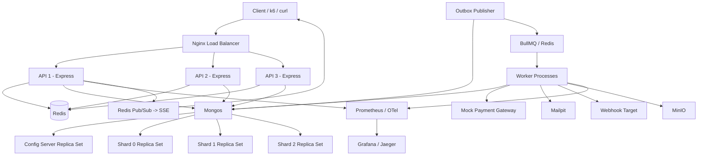
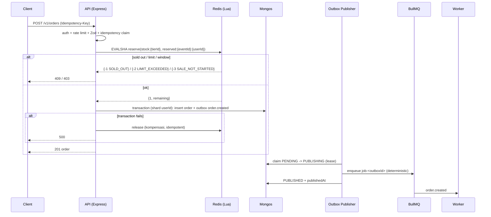
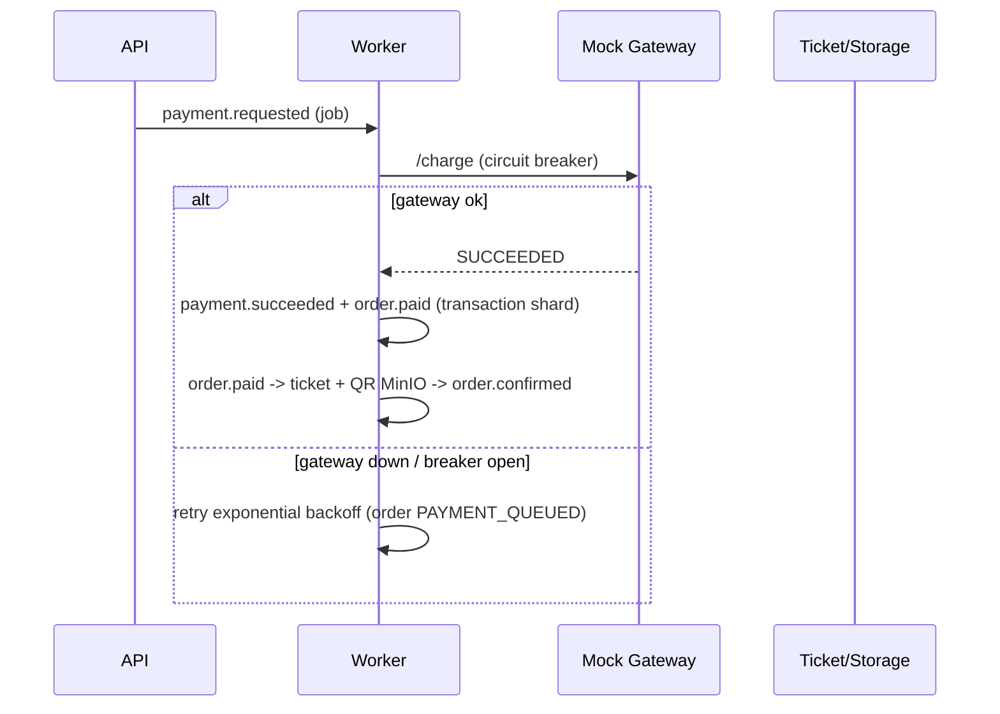

# Arsitektur TixWar

Dokumen ini mencerminkan implementasi aktual pada branch `dev`, commit `60ed2d4`. Sumber kebenaran fitur: `docs/PRD.md`; keputusan yang menyimpang: `docs/adr/`.

## 1. Komponen (C4 context)

### C4 container

| Container           | Teknologi                      | Tanggung jawab                                                                  |
| ------------------- | ------------------------------ | ------------------------------------------------------------------------------- |
| `api-1..3`          | Express 5 di Bun               | HTTP stateless; auth, browse (cache), order (Lua reserve), pay, tickets, SSE.   |
| `worker`            | BullMQ di Bun                  | Konsumsi job: order, payment, notification, webhook, expiry; saga + kompensasi. |
| `outbox-publisher`  | Bun                            | Polling outbox Mongo → enqueue BullMQ dengan lease (ADR 003).                   |
| `mock-gateway`      | Express di Bun                 | Simulasi payment gateway; `/toggle-fail`, `/latency`, `/charge`.                |
| `redis`             | Redis 7 (AOF)                  | Stock gate, cache, rate limiter, pub/sub, lock, idempotency fast path.          |
| `mongos` + shard RS | MongoDB 7                      | Catatan durable, native sharding `{ userId: 1 }`.                               |
| `minio`             | S3-compatible                  | Objek QR ticket; presigned URL.                                                 |
| Observability       | Prometheus/Grafana/Loki/Jaeger | Metrik, log, trace.                                                             |

## 2. Alur order + stok Lua

`POST /v1/orders` (`src/modules/orders/service.ts`):

Script Lua reserve (`src/infra/redis/stock.ts`, `RESERVE_SCRIPT`) atomik dalam satu `EVALSHA`:

1. Cek idempotensi: `HGET reservedKey orderId` — bila ada, kembalikan `{0, stock}` (idempotent).
2. Cek sale window: `now < saleStartsAt` → `{-3}`; `now > saleEndsAt` → `{-5}`.
3. Cek key stok ada: `GET stockKey` null → `{-4 STOCK_UNAVAILABLE}`.
4. Cek batas per user: jumlah `HGETALL reservedKey` + quantity > `maxPerUser` → `{-2 LIMIT_EXCEEDED}`.
5. Cek stok cukup: `stock < quantity` → `{-1 SOLD_OUT}`.
6. `DECRBY stockKey` + `HSET reservedKey orderId quantity` + `PEXPIRE`.

Release idempoten (`RELEASE_SCRIPT`): `HGET` quantity, `HDEL`, lalu `INCRBY` stok — order yang sama tidak mengembalikan stok dua kali.

**Fail-closed** (ADR 005): error koneksi Redis atau key stok belum ada → `503 DEPENDENCY_UNAVAILABLE`, tidak ada stok dikurangi, `Retry-After: 5`. Pre-warm mengisi stok 5 menit sebelum sale (`src/modules/stock/prewarm.ts`); rekonsiliasi per menit membandingkan stok Redis dengan durable dan menulis `stock_reconcile_drift` (`src/modules/stock/reconcile.ts`).

## 3. Outbox + saga

- **Outbox** (`src/events/outbox.ts`): dokumen `outboxEvents` ditulis dalam transaction yang sama dengan aggregate. Envelope: `id, type, occurredAt, requestId, aggregateId, userId, data, schemaVersion`.
- **Publisher** (`src/events/publisher.ts`): polling + lease (ADR 003). Claim `PENDING → PUBLISHING` via `findOneAndUpdate` bersyarat; enqueue BullMQ dengan `jobId` deterministik `job-<outboxId>`; `PUBLISHED` hanya setelah enqueue sukses. Gagal → backoff eksponensial + jitter, setelah `OUTBOX_MAX_ATTEMPTS` → `DEAD_LETTER` (replay via `scripts/dlq.ts`).
- **Dedupe**: `processedEvents` unique index `{ userId, eventId, consumer }` — duplicate delivery tidak menggandakan side effect.
- **Worker** (`src/events/handlers.ts`): handler per tipe event. Pembayaran lewat circuit breaker; retry `payment.requested` hingga `MAX_PAYMENT_ATTEMPTS`.

Tipe event: `order.created`, `order.paid`, `order.confirmed`, `order.expired`, `order.cancelled`, `payment.requested`, `payment.succeeded`, `payment.failed`, `stock.released`, `notification.email`, `webhook.deliver`.

## 4. Sharding

- Shard key baseline `{ userId: 1 }` ranged untuk `orders`, `payments`, `tickets`, `outboxEvents`, `processedEvents`, `auditLogs` (ADR 004).
- `userId` = `usr_` + UUIDv4 (acak, non-sekuensial) → insert tersebar, bukan menumpuk di ujung rentang.
- Unique index koleksi sharded diawali `userId`: `orders {userId,_id}`, `tickets {userId,_id}` + `{userId,code}`, `processedEvents {userId,eventId,consumer}`, dst.
- `users`, `events`, `ticketTiers`, `idempotencyKeys`, `apiKeys`, `refreshTokens`, `webhookEndpoints`, `eventStats` **unsharded** (unique global sederhana).
- Semua query transaksi menyertakan `userId` → `SINGLE_SHARD`; query admin lintas user → scatter-gather (`SHARD_MERGE`).
- `scripts/reshard.ts` dry-run default, `--execute` untuk `reshardCollection`. `scripts/verify-sharding.ts` memeriksa shard key, prefix unique index, distribusi.

## 5. Cache

Cache-aside Redis (`src/infra/redis/cache.ts`):

- List event TTL 30s, detail 60s, negative 404 10s (jitter).
- Cache key dari query ternormalisasi + version key (`events:ver`, `event:{id}:ver`). Urutan parameter tidak memengaruhi key (`normalizeCacheQuery` + `hashRequest`).
- Invaldasi admin menaikkan version key; key lama dibiarkan kedaluwarsa.
- Anti-stampede: single-flight lokal + `SET NX PX`. Cache baca fail-open (Redis mati → query Mongo langsung).
- ETag dari representasi + version; `If-None-Match` cocok → 304.
- Metrik: `cache_hits_total`, `cache_misses_total`, `cache_stale_served_total`.

## 6. Rate limit

`rate-limiter-flexible` dengan Redis store (`src/middleware/rateLimit.ts`). Tier: `anon-browse` (120/mnt/IP), `global` (300/mnt/IP), `login` (5/mnt/IP+email + lockout 10 gagal/jam), `order-user` (3/mnt), `order-ip` (30/mnt), `pay-user` (5/mnt). Semua configurable via env. Redis mati → fail-open ke `RateLimiterMemory` yang lebih ketat (per-instance, bukan distributed). Header `RateLimit-*` + `Retry-After`, metrik `rate_limit_rejected_total`.
